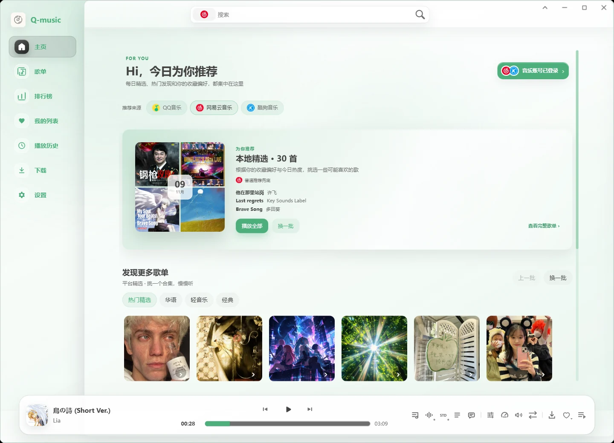
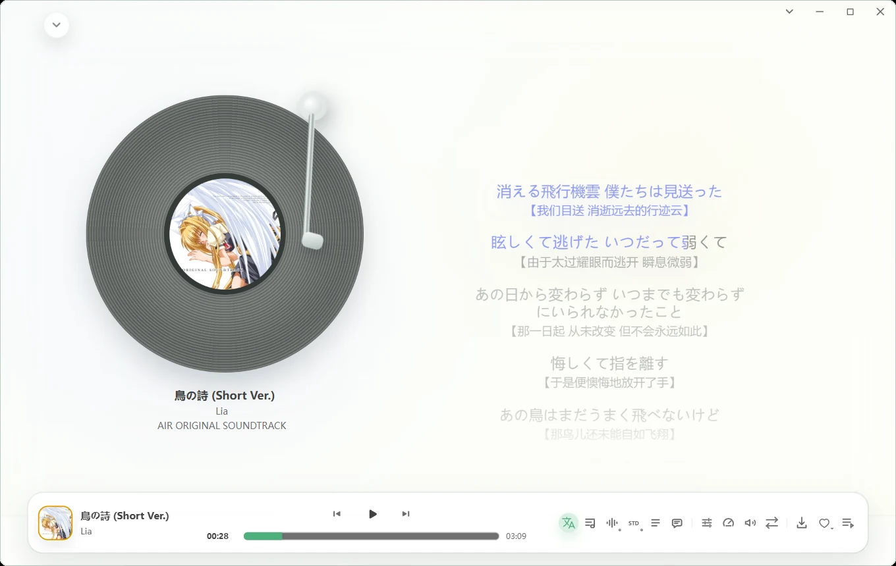
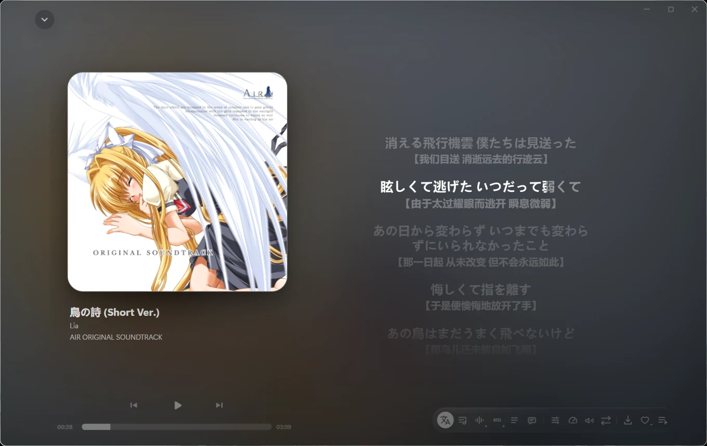
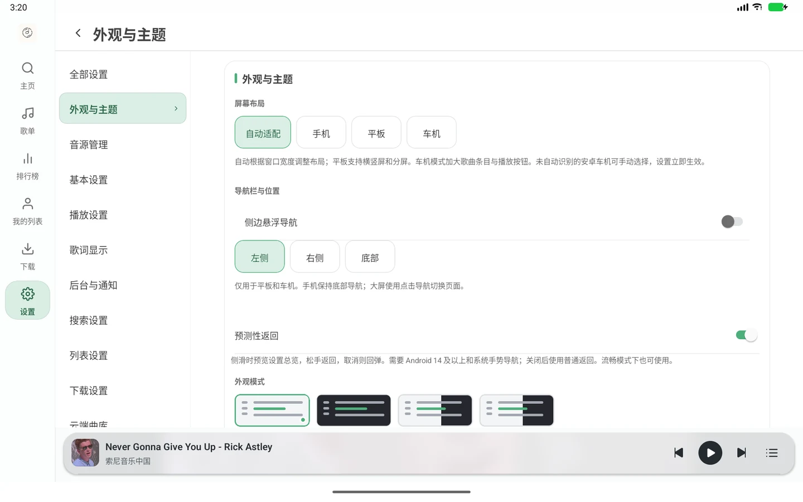

  

<h1 align="center">Q-music</h1>

把喜欢的音乐放在一起。

基于 LX Music 二次开发，支持 Windows、macOS、Arch Linux 与 Android。

  
  
  
  

  <a href="https://github.com/Nshpiter/Q-music/releases/latest"><strong>下载最新版</strong></a> ·
  <a href="#界面预览">界面预览</a> ·
  <a href="#开始使用">开始使用</a> ·
  <a href="./publish/changeLog.md">更新日志</a> ·
  <a href="https://github.com/Nshpiter/Q-music/issues">反馈问题</a>

Q-music 是基于 LX Music 二次开发的音乐播放器。可以在这里搜索歌曲、整理歌单，也可以登录自己的 QQ 音乐、网易云音乐或酷狗账号，继续听熟悉的收藏和每日推荐。

第一次使用时，请先导入自己的音源，或添加本地音乐。平台账号用于歌单、推荐和收藏，播放与下载仍需要可用音源。

## 界面预览

**桌面首页 · 每日精选与更多歌单**

<table>
  <tr>
    <td width="50%" align="center"><strong>经典极简 · 封面与双语歌词</strong></td>
    <td width="50%" align="center"><strong>沉浸歌词 · 封面取色与动态氛围</strong></td>
  </tr>
  <tr>
    <td></td>
    <td></td>
  </tr>
</table>

**Android · 经典与沉浸，两种听歌方式**

  
  

展开查看平板设置与导航

平板与车机支持左侧、右侧和底部导航，可以按自己的使用习惯选择。

## 可以做什么

### 找歌与发现

- **搜索歌曲**：可以一起搜索多个平台，也可以只选一个。支持综合和音质排序，点开搜索框就能看到历史记录、热搜与搜索建议。
- **账号与推荐**：登录 QQ 音乐、网易云音乐或酷狗，查看自己的歌单和每日推荐。首页也保留了精选歌单、分类发现与热门歌手，想换个口味时可以逛逛。
- **B 站音频**：搜索视频、输入 BV 号或链接，也能导入公开收藏夹。支持多 P、合集和系列，加入队列后可以连续播放。
- **听歌识曲（Android）**：点一下搜索栏的麦克风，听取一小段音乐后自动识别。开始前会说明录音和音频上传的用途。

### 听歌与管理

- **播放页与歌词**：经典极简和沉浸歌词两种风格，支持双语、逐字歌词，以及跟随封面取色的动态背景。歌词和翻译是否齐全取决于歌词源。
- **收藏到自己想要的地方**：点爱心收藏到默认本地歌单。PC 点爱心右下角的三角，手机长按爱心或打开更多菜单，可以改选其他本地歌单，或收藏到已登录平台中自己有编辑权限的歌单。B 站内容可收藏到本地。
- **播放队列**：从队列移除歌曲，不会删掉原歌单里的收藏。「播放全部」可以替换当前队列，也可以追加到后面；安卓还支持拖动排序。
- **播放历史**：找回刚听过的歌，也能单条删除、清空或调整保存数量。PC 入口在左侧导航，手机在「我的」。
- **本地音乐与下载**：导入歌曲或文件夹，管理下载任务和保存位置。删除歌曲文件、清理下载记录都有各自的操作入口。
- **网易云播放记录**：登录后，播放网易云来源的歌曲时按实际收听时长回传记录；使用第三方音源时仍保留原曲信息。PC 和安卓均支持。
- **智能换源**：播放失败时按设置尝试备用线路，也可以选择是否自动降低音质、是否跨平台找歌，以及优先保留平台还是音质。

### 外观与设备

- **主题随心调整**：支持浅色、深色、跟随系统和自定义时段切换，切换明暗时保留主题配色；还可调整背景图、透明度和播放风格。
- **玻璃效果可选**：喜欢通透效果可以打开液态玻璃，更看重流畅度可以关闭模糊或启用流畅模式。安卓默认关闭实时玻璃。
- **适合不同屏幕**：安卓提供手机、平板和车机布局，设置里可以搜索选项；支持后台播放和系统媒体控制。
- **桌面歌词**：PC 支持桌面歌词和全局快捷键；安卓提供独立悬浮歌词，也支持词幕。

## 开始使用

1. **[下载安装包](https://github.com/Nshpiter/Q-music/releases/latest)**。发布页里有各平台的选包和安装说明。
2. **导入音源**。PC 在「设置 → 自定义源管理」中导入，安卓在「我的 → 设置 → 音源管理」。选好主音源后，也可以添加备用音源；听本地音乐则直接导入歌曲即可。
3. **开始听歌**。搜索歌曲，或登录平台账号查看自己的歌单和推荐。歌曲菜单里可以收藏、加入队列或下载，手机的下载目录在设置首页就能找到。
4. **需要换设备时再配置同步或备份**。下面列出了几种方式，按自己的需要选择就好。

## 歌单同步、云端曲库与配置备份

同步歌单、存放音乐和迁移设置是三件不同的事：

| 你想做的事 | 使用方式 | 范围 |
| --- | --- | --- |
| 在多台设备间同步 Q-music 歌单 | 自建 [同步服务](./deploy/sync-server/README.md)，在设置中连接 | 自动同步歌单与“不喜欢”列表 |
| 把云盘当作自己的音乐库 | 连接 S3 兼容存储（含 Cloudflare R2）或 WebDAV | 手动上传歌曲，导入云端歌曲 / 歌单 |
| 把设置和音源迁移到另一台设备 | 同一连接内选择「设置与音源」 | 手动加密备份 / 恢复通用设置、完整音源脚本和主备顺序；可选账号状态 |

设置和音源需要手动备份、手动恢复，记得保管好备份密钥。账号状态默认不上传，可以自行勾选；在新设备上还需要重新设置下载目录和系统权限。具体操作见 [配置备份指南](./doc/cloud-config-backup.md)。

## 常见问题

为什么装好后不能直接播放或下载？

先在音源管理中导入可用音源并检查主备选择。平台登录主要提供歌单、推荐及收藏能力；可用音质、播放和下载取决于音源及对应内容。失败时请一并反馈平台、歌曲、错误提示与音源名称，不要公开密钥。

为什么歌单同步或收藏提示重新登录、需要验证？

平台凭证会过期，平台也可能要求安全验证。请按提示重新授权或完成验证，再刷新歌单；只有本人有写入权限的歌单才会出现在平台收藏目标中。

安卓歌词、后台播放和耗电怎么设置？

独立悬浮歌词需授予悬浮窗权限；通知和后台播放按系统提示授权。厂商系统仍可能限制后台运行。觉得模糊或动效吃性能时，先关闭液态玻璃或开启流畅模式，无需更换主题。

便携版怎么更新，数据在哪里？

完整解压便携包后运行 `Q-music.exe`，数据在 `portable/userData`。升级前退出程序，将新版解压到新目录，再复制旧版 `portable` 文件夹。安装版数据通常在 `%APPDATA%/q-music`；更多路径与 Linux 说明见 [桌面端开发与数据目录](./doc/development.md)。

## 开发与反馈

桌面源码在本仓库默认分支，Android 源码在 [`android` 分支](https://github.com/Nshpiter/Q-music/tree/android)。

- [桌面端开发、构建与 Linux 说明](./doc/development.md)
- [Android 使用与构建](https://github.com/Nshpiter/Q-music/blob/android/README.md)
- [macOS 安装与双架构构建](./doc/macos-build.md)
- [完整更新日志](./publish/changeLog.md)

问题请提交至 [Issues](https://github.com/Nshpiter/Q-music/issues)，附上系统与软件版本、复现步骤、错误提示，以及必要的截图或歌曲 / 歌单链接。请勿公开账号 Cookie、Token、音源密钥或私有配置。

## 致谢与许可

Q-music 基于 [LX Music Desktop](https://github.com/lyswhut/lx-music-desktop) 与 [LX Music Mobile](https://github.com/lyswhut/lx-music-mobile) 二次开发，是独立项目；不代表上游或音乐平台官方。

感谢 [WalnutBai/lx-lxwalnut-music-mobile](https://github.com/WalnutBai/lx-lxwalnut-music-mobile) 等开源项目提供的实现参考，也感谢 [LINUX DO 社区](https://linux.do/) 的交流与反馈。

项目使用 [Apache License 2.0](./LICENSE)，保留上游归属与协议；详见 [NOTICE](./NOTICE) 和 [二次修改说明](./MODIFICATIONS.md)。音乐、歌词、封面及平台商标归各自权利人所有，使用时请遵守适用的法律、平台条款与版权要求。

## Star 趋势

<a href="https://star-history.com/#Nshpiter/Q-music&amp;Date">
  <picture>
    <source media="(prefers-color-scheme: dark)" srcset="https://api.star-history.com/svg?repos=Nshpiter/Q-music&amp;type=Date&amp;theme=dark">
    <source media="(prefers-color-scheme: light)" srcset="https://api.star-history.com/svg?repos=Nshpiter/Q-music&amp;type=Date">
    
  </picture>
</a>
