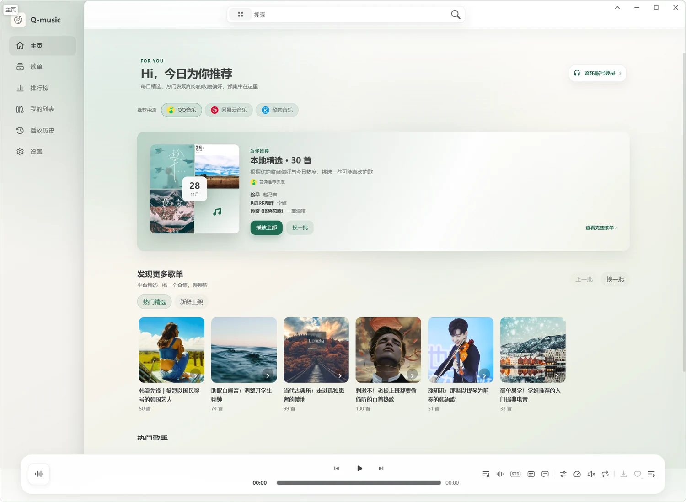
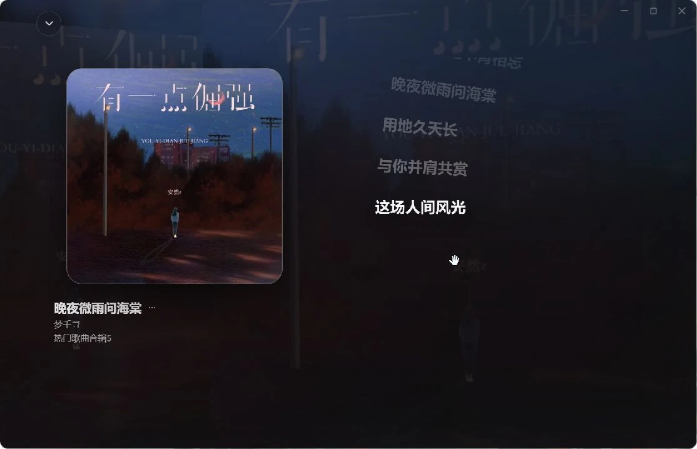
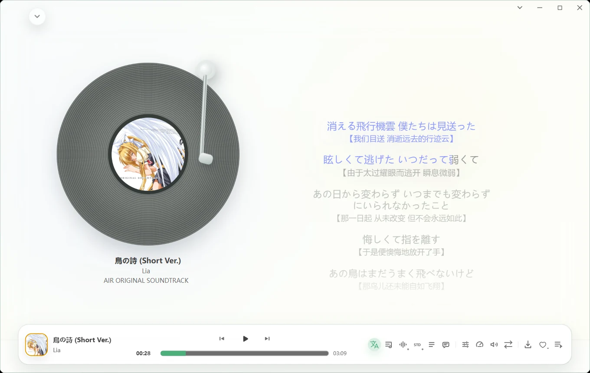
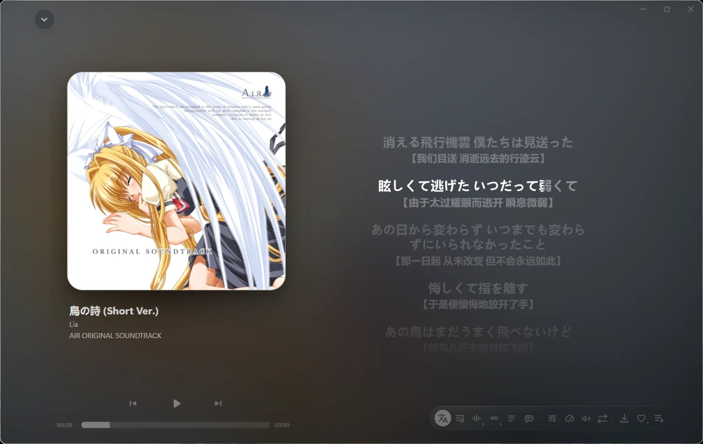
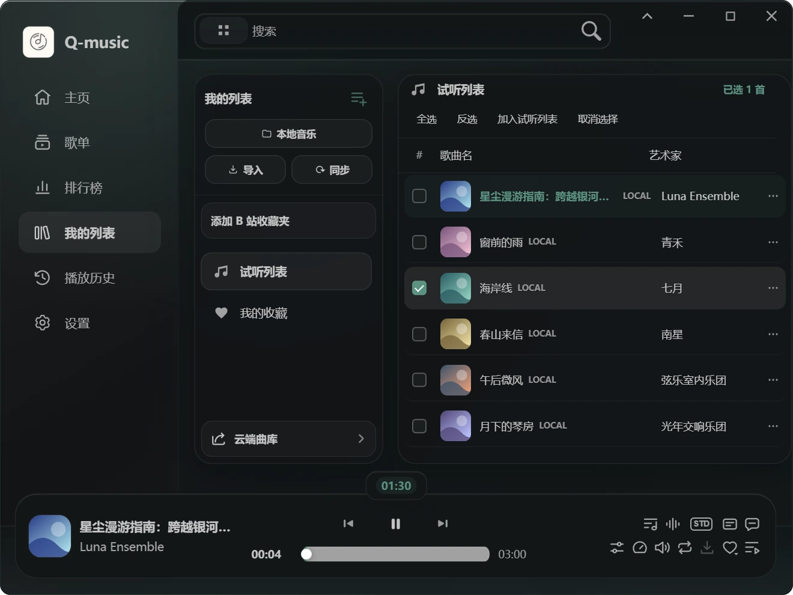
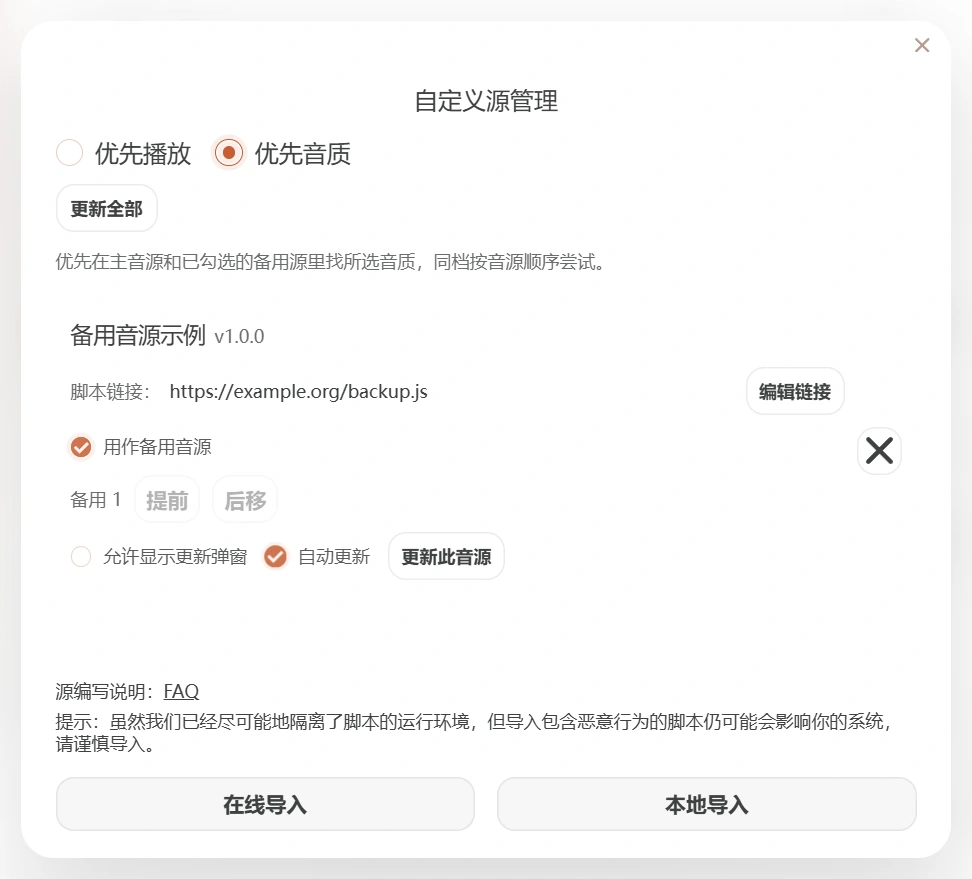
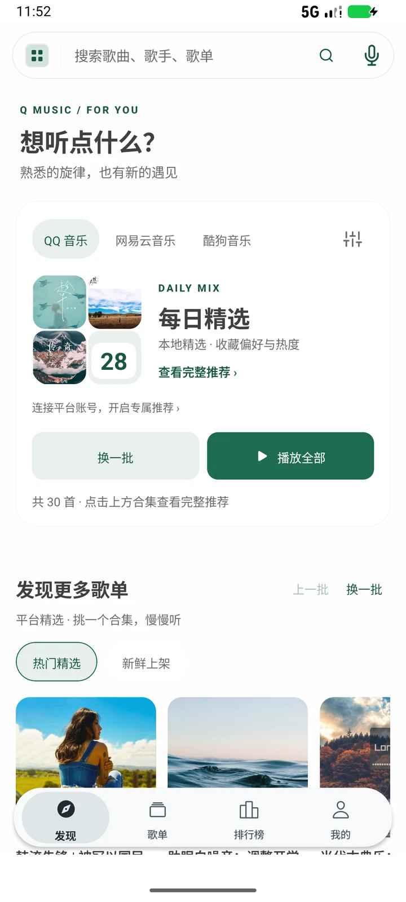
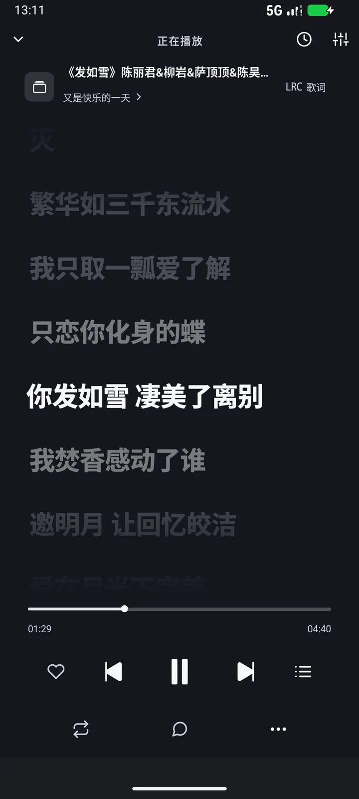
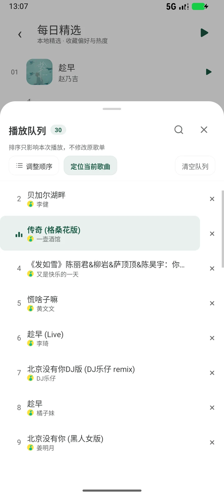
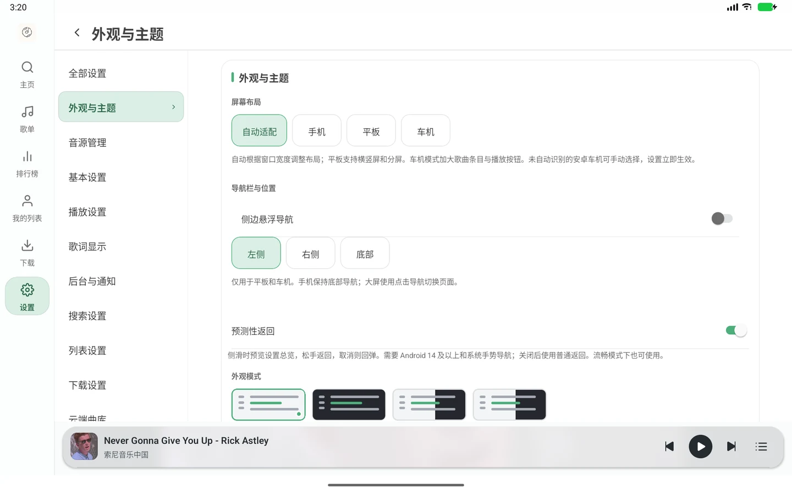

  

<h1 align="center">Q-music</h1>

基于 LX Music 二次开发，支持 Windows、macOS、Arch Linux 与 Android。

  
  
  
  

  <a href="https://github.com/Nshpiter/Q-music/releases/latest"><strong>下载最新版</strong></a> ·
  <a href="#界面预览">桌面预览</a> ·
  <a href="#手机上的-q-music">安卓预览</a> ·
  <a href="#开始使用">开始使用</a> ·
  <a href="./publish/changeLog.md">更新日志</a> ·
  <a href="https://github.com/Nshpiter/Q-music/issues">反馈问题</a>

Q-music 既能搜索多个平台的歌曲，也能接着听自己在 QQ 音乐、网易云音乐和酷狗收藏的歌单。在线听歌需要导入可用音源，听本地音乐可以直接添加文件或文件夹。

## 界面预览

首页可以在三个平台之间切换。登录后，点开每日推荐就能看完整曲目，往下翻还能逛精选歌单和热门歌手。想找一首听过的歌，点搜索框就能接着用上次的搜索记录。

**B 站合集也能当歌单听。** 搜索时切到哔哩哔哩，输入视频名、BV 号或链接。多 P 视频可以先选一集，播放后打开队列就能换集，点下一首会接着播下一 P。公开收藏夹、合集和系列也能导入本地。[B 站音频与导入说明](./docs/bilibili.md)

### 播放页与歌词

经典极简把唱片和歌词并排放，沉浸氛围会用封面的颜色铺满背景。桌面播放页打开「播放页外观 → 歌词排列」，可以在直排和扇形之间切换，扇形的弧度也能调。双语和逐字高亮取决于歌曲提供的歌词。

对照经典极简与沉浸氛围的播放页

  
  

在电脑上做别的事时，可以从播放页外观里的「悬浮窗口」打开置顶的迷你播放器或歌词胶囊。安卓在播放详情点「歌词」，搜一句原词或译文，点结果就能从那句开始听。

### 收藏和播放队列

点爱心会把歌收进默认本地歌单。想挑歌单，桌面点爱心右下角的小三角，手机长按爱心即可。QQ 音乐、网易云和酷狗的歌曲可以存回同一平台下自己有编辑权限的歌单，B 站视频可以收进本地歌单。

一次选几首歌点「下一首播放」，就能按顺序插在当前歌曲后面。「稍后播放」会排在后面。从队列里移除一首歌，原歌单里仍然留着它。想找回昨天听的歌，桌面点左栏的「播放历史」，手机从「我的」进入。登录网易云后，网易云来源歌曲的播放记录还可以按实际收听时长回传到账号。

### 管理和更新音源

桌面打开「设置 → 自定义源管理」，安卓打开「我的 → 设置 → 音源管理」。在线导入会记住脚本链接，从文件导入的音源也能补填链接。点「更新此音源」或「更新全部」就能替换旧脚本，主音源和备用顺序都会保留。希望自动更新的音源可以单独打开开关。

  

用多个音源时，可以选「优先播放」或「优先音质」。例如你选了 SQ，主音源只有 HQ，而备用音源能提供 SQ，「优先音质」会先尝试备用音源的 SQ。

### 手机上的 Q-music

从发现页点进每日精选，播放后可以切到沉浸歌词，也可以打开队列搜索、定位当前歌曲或调整顺序。下图依次是这三个界面，点图可看原尺寸。

  
  
  

手机也能听歌识曲。点搜索栏的麦克风，再点「开始听歌识曲」，听完一小段就会自动识别。平板和车机可以把导航放在左侧、右侧或底部。

查看平板的双栏设置和导航选项

## 开始使用

1. 打开[最新正式版](https://github.com/Nshpiter/Q-music/releases/latest)，按发布说明选择适合设备的安装包。
2. 添加本地音乐，或导入自己的在线音源。登录平台账号后，还能读取个人歌单、推荐和收藏。
3. 在歌曲菜单里可以收藏、插播或下载。安卓的下载目录在设置首页，桌面的下载任务里分别提供清理记录和删除文件的操作。

在外观设置里可以试试默认的「松烟暖白」和「暖白陶土」。明暗模式支持跟随系统或自定义时段，两种模式下都会保留所选主题的配色。喜欢通透效果可以打开玻璃，想减少模糊和动效可以开流畅模式。

## 歌单同步、云端曲库与配置备份

| 你想做的事 | 使用方式 | 范围 |
| --- | --- | --- |
| 在多台设备间同步 Q-music 歌单 | 自建 [同步服务](./deploy/sync-server/README.md)，在设置中连接 | 自动同步歌单与“不喜欢”列表 |
| 把云盘当作自己的音乐库 | 连接 S3 兼容存储（含 Cloudflare R2）或 WebDAV | 手动上传歌曲，导入云端歌曲 / 歌单 |
| 把设置和音源迁移到另一台设备 | 同一连接内选择「设置与音源」 | 手动加密备份 / 恢复通用设置、完整音源脚本和主备顺序；可选账号状态 |

设置和音源需要手动备份、手动恢复，记得保管好备份密钥。账号状态默认不上传，可以自行勾选；在新设备上还需要重新设置下载目录和系统权限。具体操作见 [配置备份指南](./doc/cloud-config-backup.md)。

## 常见问题

为什么装好后不能直接播放或下载？

先在音源管理中导入可用音源并检查主备选择。平台登录主要提供歌单、推荐及收藏能力；可用音质、播放和下载取决于音源及对应内容。失败时请一并反馈平台、歌曲、错误提示与音源名称，不要公开密钥。

为什么歌单同步或收藏提示重新登录、需要验证？

平台凭证会过期，平台也可能要求安全验证。请按提示重新授权或完成验证，再刷新歌单；只有本人有写入权限的歌单才会出现在平台收藏目标中。

安卓歌词、后台播放和耗电怎么设置？

独立悬浮歌词需授予悬浮窗权限；通知和后台播放按系统提示授权。厂商系统仍可能限制后台运行。觉得模糊或动效吃性能时，先关闭液态玻璃或开启流畅模式，无需更换主题。

便携版怎么更新，数据在哪里？

完整解压便携包后运行 `Q-music.exe`，数据在 `portable/userData`。升级前退出程序，将新版解压到新目录，再复制旧版 `portable` 文件夹。安装版数据通常在 `%APPDATA%/q-music`；更多路径与 Linux 说明见 [桌面端开发与数据目录](./doc/development.md)。

## 开发与反馈

桌面源码在本仓库默认分支，Android 源码在 [`android` 分支](https://github.com/Nshpiter/Q-music/tree/android)。

- [桌面端开发、构建与 Linux 说明](./doc/development.md)
- [Android 使用与构建](https://github.com/Nshpiter/Q-music/blob/android/README.md)
- [macOS 安装与双架构构建](./doc/macos-build.md)
- [完整更新日志](./publish/changeLog.md)

问题请提交至 [Issues](https://github.com/Nshpiter/Q-music/issues)，附上系统与软件版本、复现步骤、错误提示，以及必要的截图或歌曲 / 歌单链接。请勿公开账号 Cookie、Token、音源密钥或私有配置。

## 致谢与许可

Q-music 基于 [LX Music Desktop](https://github.com/lyswhut/lx-music-desktop) 与 [LX Music Mobile](https://github.com/lyswhut/lx-music-mobile) 二次开发，是独立项目；不代表上游或音乐平台官方。

感谢 [WalnutBai/lx-lxwalnut-music-mobile](https://github.com/WalnutBai/lx-lxwalnut-music-mobile) 等开源项目提供的实现参考，也感谢 [LINUX DO 社区](https://linux.do/) 的交流与反馈。

项目使用 [Apache License 2.0](./LICENSE)，保留上游归属与协议；详见 [NOTICE](./NOTICE) 和 [二次修改说明](./MODIFICATIONS.md)。音乐、歌词、封面及平台商标归各自权利人所有，使用时请遵守适用的法律、平台条款与版权要求。

## Star 趋势

<a href="https://star-history.com/#Nshpiter/Q-music&amp;Date">
  <picture>
    <source media="(prefers-color-scheme: dark)" srcset="https://api.star-history.com/svg?repos=Nshpiter/Q-music&amp;type=Date&amp;theme=dark">
    <source media="(prefers-color-scheme: light)" srcset="https://api.star-history.com/svg?repos=Nshpiter/Q-music&amp;type=Date">
    
  </picture>
</a>
